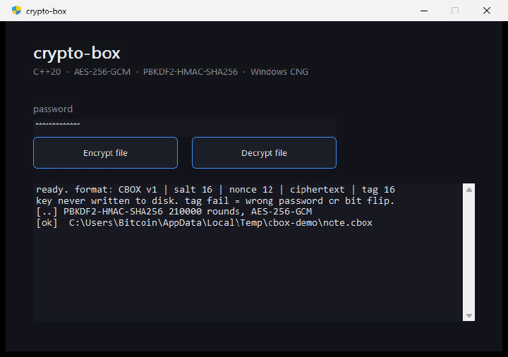

# crypto-box

C++20 Win32 file encryptor. AES-256-GCM, PBKDF2-HMAC-SHA256 (210000 rounds), Windows CNG. Password and key never written to disk.



## interface

Dark Win32 window, 520×420, no extra pages.

```
┌ crypto-box ─────────────────────────────────────┐
│ crypto-box                                      │
│ C++20 · AES-256-GCM · PBKDF2-HMAC-SHA256 · CNG  │
│                                                 │
│ password  [ •••••••••••• ]                      │
│                                                 │
│ [ Encrypt file ]     [ Decrypt file ]           │
│                                                 │
│ ┌ log ────────────────────────────────────────┐ │
│ │ ready. format: CBOX v1 | salt 16 | nonce 12 │ │
│ │ ciphertext | tag 16                         │ │
│ │ [ok]  note.cbox                             │ │
│ └─────────────────────────────────────────────┘ │
└─────────────────────────────────────────────────┘
```

| control | what it does |
|---|---|
| **password** | masked edit. same string for encrypt and decrypt. never saved |
| **Encrypt file** | Open file → Save As `.cbox`. PBKDF2 → AES-256-GCM. log `[ok] path` |
| **Decrypt file** | Open `.cbox` → Save As plaintext. tag check. wrong password → fail, no file |
| **log** | format reminder, round count, `[ok]` / tag-fail |

Flow: type password → Encrypt file → pick a file → pick where to write `.cbox` → log shows `[ok]`. Decrypt is the same password, other button, other picker.

Wrong password or a flipped bit in the box → GCM tag fail, plaintext is not written. File encrypt/decrypt maps the file (`MapViewOfFile`) instead of a heap vector — same CBOX v1 blob, cap 4 GiB − 1 (CNG `ULONG`). New boxes bind `CBOX` + version as GCM AAD; older boxes without AAD still decrypt.

Password, derived key, and plaintext buffers are wiped with `SecureZeroMemory` after use. Password is never written to disk.

## file

`CBOX` v1 | salt 16 | nonce 12 | ciphertext | tag 16.

Ciphertext length is `filesize − header − tag`. No extra length field — boxes from before this pass still open.

## build

```
cmake -S . -B build -G "Visual Studio 18 2026" -A x64
cmake --build build --config Release
ctest --test-dir build -C Release --output-on-failure
.\build\Release\crypto-box.exe
```

`cbox_tests` is a console binary (no UI): roundtrip, wrong password, truncated, tag bit-flip, legacy AAD fallback, 3 MiB mapped file.
